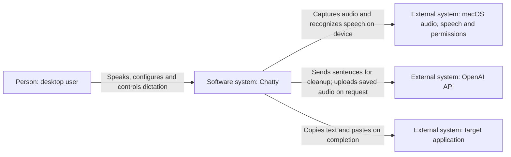
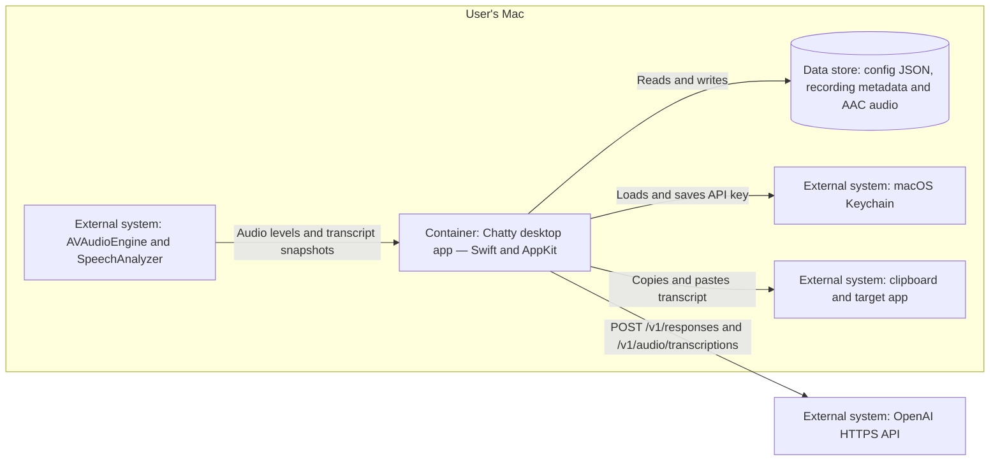
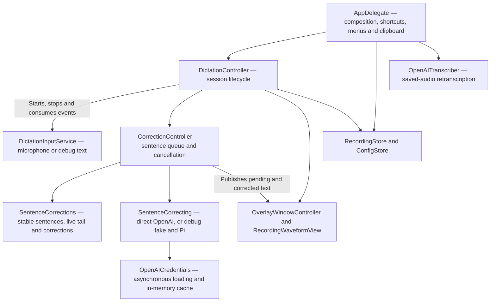

# Chatty architecture

Chatty is one local Swift/AppKit application. Production runs in the menu bar;
the debug build opens a floating control window and substitutes typed input for
the microphone. Both use the same dictation and sentence-cleanup pipeline.

## C1 — System context

Live speech recognition stays on the Mac. Stable sentence text, the configured
cleanup prompt, and word dictionary go to OpenAI. Retranscribing a saved
recording uploads its audio separately.

## C2 — Containers

The deployable container is the desktop app; there is no Chatty backend server.

Files live under `~/Library/Application Support/Chatty/`: `config.json`,
`recordings.json`, and `Recordings/`. Cleanup credentials come from `OPENAI_API_KEY`
when supplied, otherwise Keychain; they stay out of config and diagnostics.

## C3 — App components

| Boundary | Responsibility and source |
| --- | --- |
| Composition and UI | [main.swift](../Sources/Chatty/main.swift) injects services, wires shortcut and overlay actions, settings, clipboard and paste callbacks. [DebugPanelController](../Sources/Chatty/DebugPanelController.swift) drives the same core and exposes request diagnostics. |
| Session lifecycle | [DictationController](../Sources/Chatty/DictationController.swift) owns preparation, listening, finishing, completion and failure. Session IDs reject stale input after cancel or restart. |
| Input | [DictationInputService](../Sources/Chatty/DictationInputService.swift) emits transcript snapshots, levels and file size. [MicrophoneDictationService](../Sources/Chatty/MicrophoneDictationService.swift) copies one audio tap into an actor that feeds local speech recognition and AAC recording. [DebugTextInputService](../Sources/Chatty/DebugTextInputService.swift) emits matching events from typed or replayed text. |
| Cleanup | [CorrectionController](../Sources/Chatty/CorrectionController.swift) serializes requests through `SentenceCorrecting`. [SentenceCorrections](../Sources/Chatty/SentenceCorrections.swift) splits stable text, retains unchanged corrections and rejects results for edited sentence IDs. |
| API boundary | [OpenAISentenceCorrector](../Sources/Chatty/OpenAISentenceCorrector.swift) reuses a URLSession, validates responses and cancels individual requests. [OpenAICredentials](../Sources/Chatty/OpenAICredentials.swift) shares a background Keychain read and caches the key; callers can cancel their wait. [DebugSentenceCorrector](../Sources/Chatty/DebugSentenceCorrector.swift) selects REST, fake or Pi and reports timings. |
| Presentation and persistence | [OverlayWindowController](../Sources/Chatty/OverlayWindowController.swift) displays live, pending and corrected text in a growing five-line viewport. [RecordingStore](../Sources/Chatty/RecordingStore.swift) saves recordings and transcripts; [ConfigStore](../Sources/Chatty/ShortcutConfig.swift) saves shortcuts and cleanup settings. [OpenAITranscriber](../Sources/Chatty/OpenAITranscriber.swift) handles saved-audio uploads. |

## Runtime contracts

- Only stable complete sentences enter cleanup during dictation; provisional
  words remain visible. Stop finalizes the remaining tail, awaits cleanup,
  saves real recordings, copies the corrected transcript, clears the overlay,
  and pastes into the original app in production.
- Escape copies the current corrected/raw text, clears the overlay, cancels
  input and pending cleanup, and discards unsaved audio. Cancelled work cannot
  update a replacement session or edited sentence.
- Recognition, cleanup and persistence failures are visible. Available audio
  is retained on failure for recovery; an incomplete transcript is not pasted.
- AppKit and session coordination use the main actor. The audio tap owns copies
  before crossing queues; conversion/file writing run in a separate actor.
  Blocking Keychain access runs on a dispatch queue, outside the UI and Swift
  cooperative executors. HTTP requests are asynchronous.

Diagrams stop at C3; the linked Swift code is the source for class-level detail.
