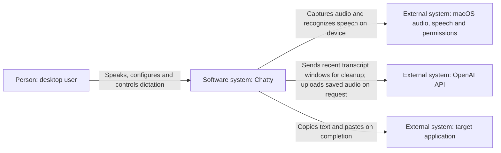
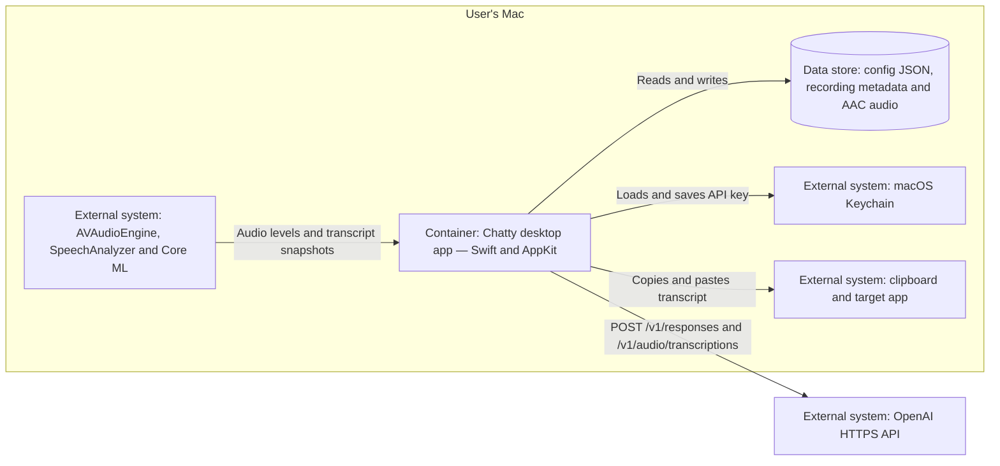
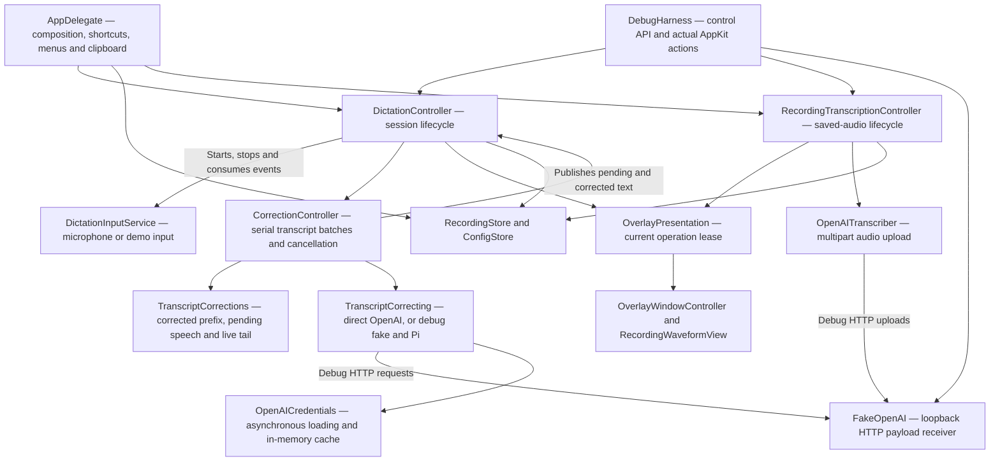

# Chatty architecture

Chatty is one local Swift/AppKit application. Production runs in the menu bar;
the debug build opens a floating control window with injected snapshots, local
Nemotron or Apple microphone recognition, typed input, and local audio replay. All use the same
dictation and transcript-cleanup pipeline. Production uses Apple recognition.

## C1 — System context

Live speech recognition stays on the Mac. Recent corrected text and new stable
sentences, the configured cleanup prompt, and word dictionary go to OpenAI. Retranscribing a saved
recording uploads its audio separately.

## C2 — Containers

The deployable container is the desktop app; there is no Chatty backend server.
[package-release.sh](../scripts/package-release.sh) builds an ad-hoc-signed Apple
Silicon app archive for GitHub Releases. The [Homebrew cask](../Casks/chatty.rb)
installs that prebuilt app in `/Applications` and links its `chatty` command;
installation does not compile Swift or reset permissions.

Production files live under `~/Library/Application Support/Chatty/`:
`config.json`, `recordings.json`, and `Recordings/`. ConfigStore and RecordingStore
receive their root at composition time. Debug defaults to the separate
`Chatty Debug/` sibling; `run-debug.sh` uses this checkout's `build/debug-data/`.
Its private clipboard, AppKit paste destination and authenticated loopback control
server isolate the default debug workflow. An explicit one-shot `systemPaste`
command captures the focused external app and uses the production activation and
CGEvent paste path. It preserves every clipboard representation in memory;
`restoreClipboard` checks and restores them after inspecting the destination.
Reset and Quit also restore a staged test clipboard. Production storage remains
separate. Cleanup credentials come from `OPENAI_API_KEY`
when supplied, otherwise Keychain; they stay out of config and diagnostics.

## C3 — App components

| Boundary | Responsibility and source |
| --- | --- |
| Composition and UI | [main.swift](../Sources/Chatty/main.swift) injects services, wires shortcut and overlay actions, settings, clipboard and paste callbacks. [DebugPanelController](../Sources/Chatty/DebugPanelController.swift) drives the same core and exposes request diagnostics. [DebugHarness](../Sources/Chatty/DebugHarness.swift) adds authenticated loopback commands, event-based waits and snapshots; [DebugUI](../Sources/Chatty/DebugUI.swift) operates actual AppKit controls. |
| Saved recordings | [RecordingTranscriptionController](../Sources/Chatty/RecordingTranscriptionController.swift) owns uploads, cancellation, retry, persistence and copy/paste callbacks. Run IDs reject stale replies; [OverlayPresentation](../Sources/Chatty/OverlayPresentation.swift) leases the overlay to the current operation so older completion/dismissal cannot replace a newer session. |
| Session lifecycle | [DictationController](../Sources/Chatty/DictationController.swift) owns preparation, listening, finishing, completion and failure. Session IDs reject stale input after cancel or restart. |
| Input | [DictationInputService](../Sources/Chatty/DictationInputService.swift) emits transcript snapshots, levels and file size. [MicrophoneDictationService](../Sources/Chatty/MicrophoneDictationService.swift) copies one audio tap into an actor for AAC recording and conversion, feeding either Apple SpeechAnalyzer or [LocalSpeechRecognizer](../Sources/Chatty/LocalSpeechRecognizer.swift). The latter owns a warm FluidAudio/Core ML Nemotron 600M model and consumes 16 kHz mono audio in 560 ms model chunks. [DebugDictationInputService](../Sources/Chatty/DebugDictationInputService.swift) selects injected snapshots, microphone, typed text, or [clock-paced file audio](../Sources/Chatty/DebugAudioReplay.swift). |
| Cleanup | [CorrectionController](../Sources/Chatty/CorrectionController.swift) serializes requests through `TranscriptCorrecting`, coalescing new speech after each reply. [TranscriptCorrections](../Sources/Chatty/TranscriptCorrections.swift) tracks raw recognition separately from corrected text and replaces only the submitted window. [TranscriptLayout](../Sources/Chatty/TranscriptLayout.swift) measures context using the overlay's font and wrapping width. |
| API boundary | [OpenAITranscriptCorrector](../Sources/Chatty/OpenAITranscriptCorrector.swift) reuses a URLSession, validates responses and cancels individual requests. [OpenAICredentials](../Sources/Chatty/OpenAICredentials.swift) shares a background Keychain read and caches the key; callers can cancel their wait. [DebugTranscriptCorrector](../Sources/Chatty/DebugTranscriptCorrector.swift) selects REST, fake or Pi and reports timings. [FakeOpenAI](../Sources/Chatty/FakeOpenAI.swift) receives the actual serialized JSON/multipart bytes over loopback HTTP, returns SCREAMING_SNAKE_CASE and injects response failures or held replies. |
| Presentation and persistence | [OverlayWindowController](../Sources/Chatty/OverlayWindowController.swift) displays live, pending and corrected text in a growing five-line viewport. [RecordingStore](../Sources/Chatty/RecordingStore.swift) saves recordings and transcripts; [ConfigStore](../Sources/Chatty/ShortcutConfig.swift) saves shortcuts and cleanup settings. [OpenAITranscriber](../Sources/Chatty/OpenAITranscriber.swift) handles saved-audio uploads. |

## Runtime contracts

- Local model preparation downloads weights once into FluidAudio's Application
  Support cache and loads them off the main actor. The demo's microphone and
  file sources share that recognizer and the audio conversion/AAC recording
  processor. Stereo inputs downmix before mono analysis and recording. Sessions
  reset encoder/decoder state while
  retaining loaded models. Small capture packets accumulate into 560 ms chunks;
  cached encoder context spans chunks within an utterance. After speech, about
  one second below -50 dBFS closes the utterance: flush remaining audio, add a
  full stop unless terminal punctuation is already present, commit the text,
  and reset decoding state for the next utterance without stopping capture.
  Shorter pauses remain in the same utterance. Complete sentences enter cleanup;
  the growing tail stays provisional. Stop also closes the final utterance before
  completing the event stream. Cancellation joins inference before a new session
  can reset its state. Transcription-only demo mode sends no text to OpenAI.
- Only stable complete sentences enter cleanup during dictation; provisional
  words remain visible. Each request includes the last configured number of
  wrapped lines (default three), expanded back to a whole sentence, and all
  pending complete speech even when that exceeds the window. Earlier corrected
  text remains fixed. One request runs at a time, and its reply supplies the
  corrected context for the next batch. The controller publishes the active
  batch's UTF-16 range with the document: the overlay highlights that full
  passage blue, queued speech yellow, and completed text green. The active
  range clears on completion, cancellation or failure. Replies contain plain text; the dictionary
  is edited only by the user. Stop finalizes the remaining tail, awaits cleanup,
  saves real recordings, copies the corrected transcript, clears the overlay,
  and pastes into the original app in production.
- Escape copies the current corrected/raw text, clears the overlay, cancels
  input and pending cleanup, and discards unsaved audio. Cancelled work cannot
  update a replacement session or a revised source prefix. Revising already
  corrected recognition invalidates its cleanup and resubmits the stable source.
- Recognition, cleanup and persistence failures are visible. Available audio
  is retained on failure for recovery; an incomplete transcript is not pasted.
- Debug defaults to injected input and loopback HTTP fake; no token is needed.
  The fake's held replies and injected input gates let scenarios wait for real
  events, cancel and then release stale work. The CLI has bounded request lists
  and explicit full-payload expansion. Debug global shortcuts start disabled.
  See [debug verification](debug-verification.md) for repeatable checks and
  external microphone/API/desktop boundaries.
- AppKit and session coordination use the main actor. The audio tap owns copies
  before crossing queues; conversion/file writing run in a separate actor.
  Blocking Keychain access runs on a dispatch queue, outside the UI and Swift
  cooperative executors. HTTP requests are asynchronous.

Diagrams stop at C3; the linked Swift code is the source for class-level detail.
