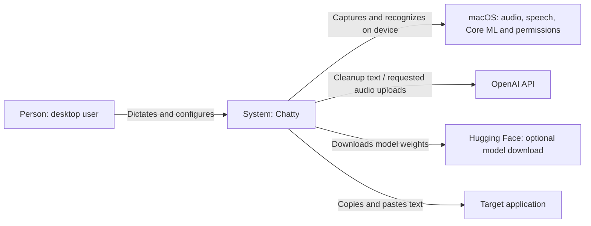
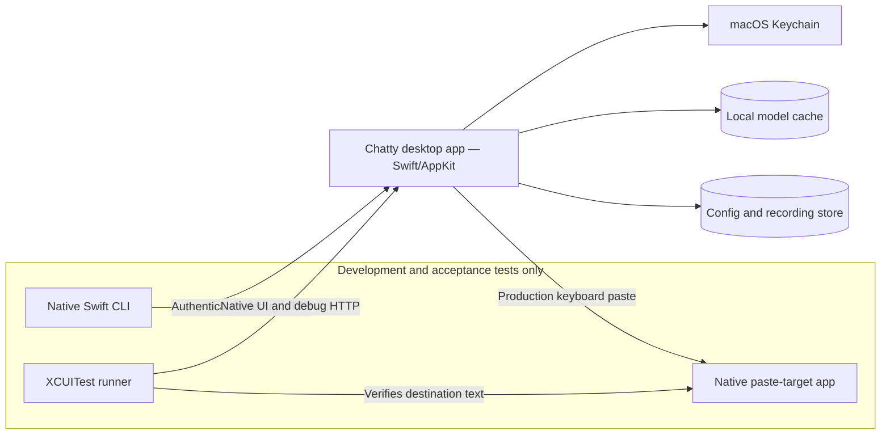
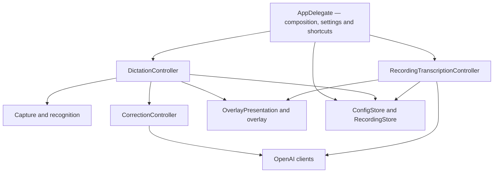

# Chatty architecture

Chatty is a Swift/AppKit menu-bar app for macOS 26 on Apple Silicon. Speech
recognition runs locally: Apple by default, or an optional Nemotron model.
OpenAI handles sentence cleanup and explicitly requested saved-audio transcription.

## C1 — System context

## C2 — Containers

Production is one desktop process. Debug builds host the control API and HTTP
fake inside that process; the native CLI, XCUITest runner and paste helper run separately.

Production data lives in `~/Library/Application Support/Chatty/`; model weights
in `~/Library/Application Support/FluidAudio/Models/`. Debug/test data roots are
injected and separate from production. Credentials come from the environment or
Keychain, and stay out of config and diagnostics.

## C3 — App components

| Module | Source |
| --- | --- |
| Composition, settings and shortcuts | [AppDelegate](../Sources/Chatty/main.swift) |
| Live session lifecycle | [DictationController](../Sources/Chatty/DictationController.swift) |
| Capture and recognition | [MicrophoneDictationService](../Sources/Chatty/MicrophoneDictationService.swift), [SpeechRecognitionSession](../Sources/Chatty/SpeechRecognitionSession.swift), [LocalSpeechRecognizer](../Sources/Chatty/LocalSpeechRecognizer.swift) |
| Cleanup and transcript state | [CorrectionController](../Sources/Chatty/CorrectionController.swift), [TranscriptCorrections](../Sources/Chatty/TranscriptCorrections.swift) |
| API clients and credentials | [OpenAITranscriptCorrector](../Sources/Chatty/OpenAITranscriptCorrector.swift), [OpenAITranscriber](../Sources/Chatty/OpenAITranscriber.swift), [OpenAICredentials](../Sources/Chatty/OpenAICredentials.swift) |
| Saved-audio lifecycle | [RecordingTranscriptionController](../Sources/Chatty/RecordingTranscriptionController.swift) |
| Presentation ownership | [OverlayPresentation](../Sources/Chatty/OverlayPresentation.swift), [OverlayWindowController](../Sources/Chatty/OverlayWindowController.swift) |
| Persistence | [ConfigStore](../Sources/Chatty/ShortcutConfig.swift), [RecordingStore](../Sources/Chatty/RecordingStore.swift) |
| Debug control | [DebugHarness](../Sources/Chatty/DebugHarness.swift), [native control client](../Sources/ChattyHarness/HarnessClient.swift) |

## Cross-component contracts

- Engine selection is persisted and captured at session start. Microphone and
  file replay share recognition and audio processing.
- Cleanup replaces the whole submitted passage: recent corrected lines plus all
  pending speech. New speech does not consume that lookback. Both cleanup clients
  decode a JSON `text` field; an explicit empty string is a successful deletion.
  Stop retains its audio/history but does not copy or paste an empty result.
  Cleanup settings persist an editable, enabled-by-default "for the tape" section;
  disabled sections retain their text but are omitted from model instructions.
- Session IDs reject stale results; overlay leases prevent background work from
  replacing the active presentation. Dictation success saves, copies and pastes; failures
  retain available audio for recovery.
- UI coordination uses the main actor. Audio conversion, inference and blocking
  Keychain work run outside it; capture buffers are copied before crossing queues.

Detailed behavior belongs to the linked source and [native UI contracts](../Tests/ChattyUITests/DictationUITests.swift).
Test selection/procedure lives in [the agent testing guide](testing.md), with
coverage limits in [verification](verification.md);
recognizer tradeoffs live in [speech research](local-speech-research.md).
